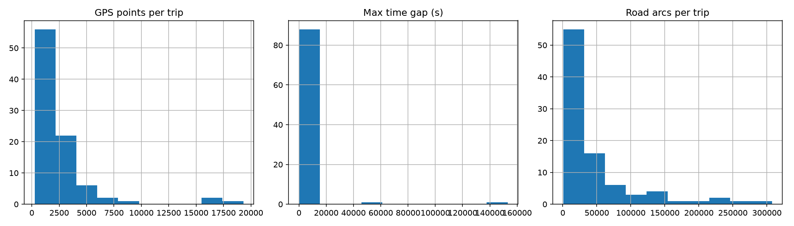
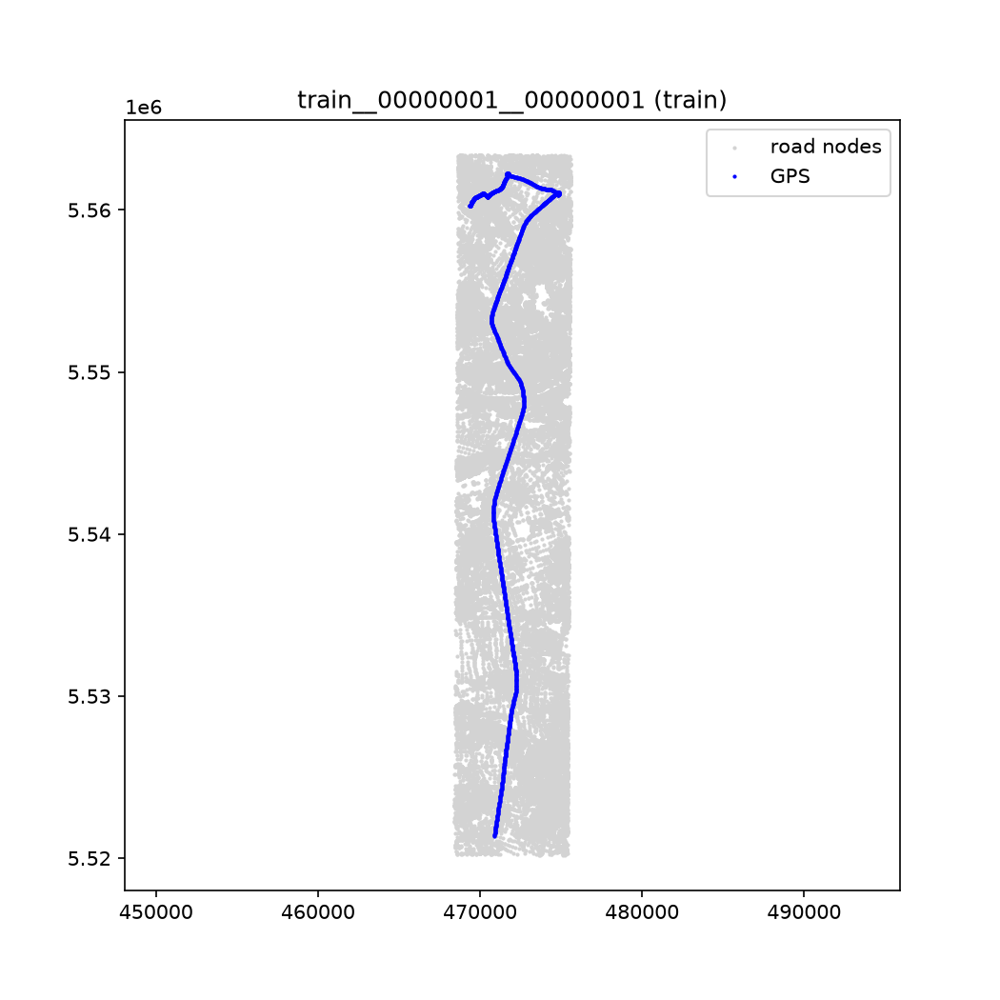
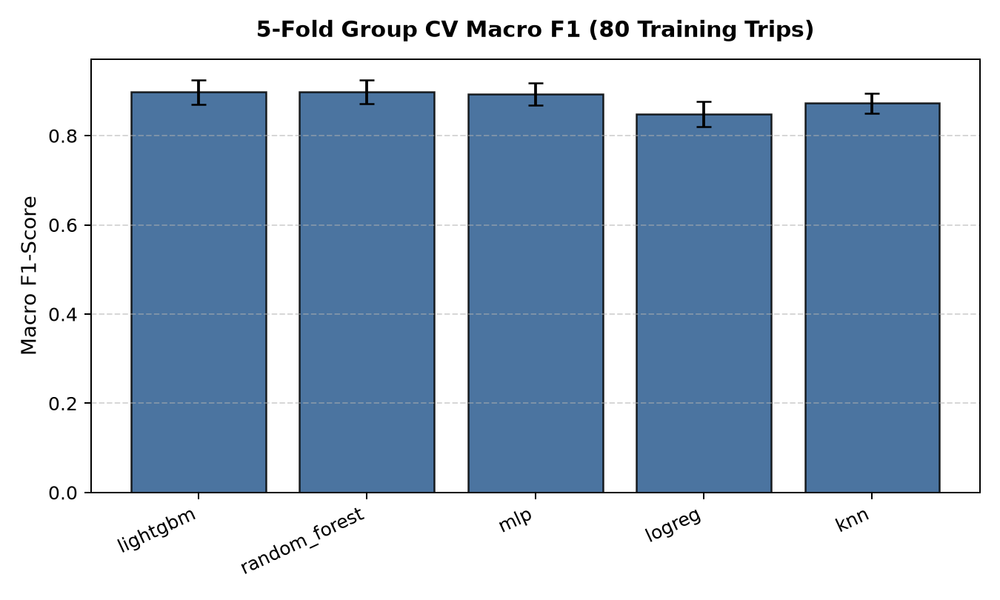
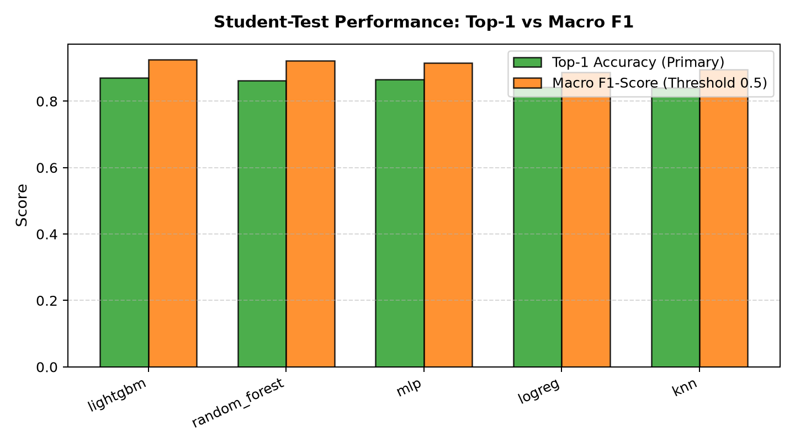
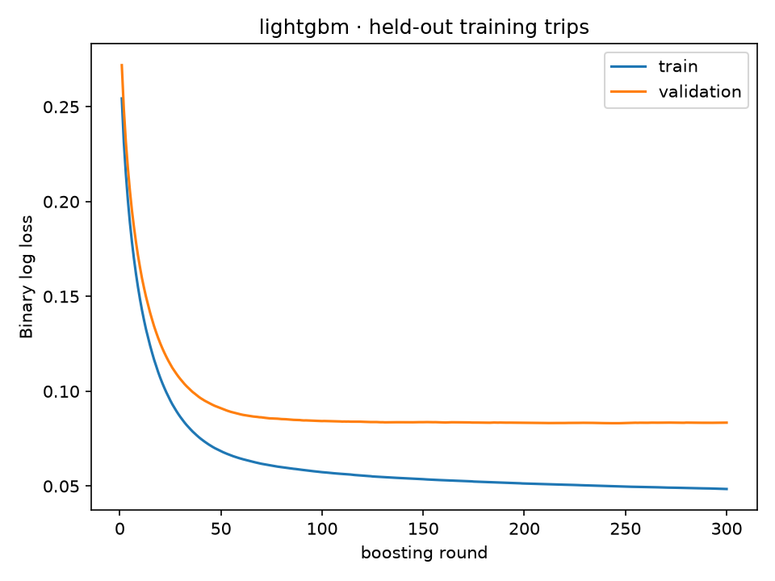
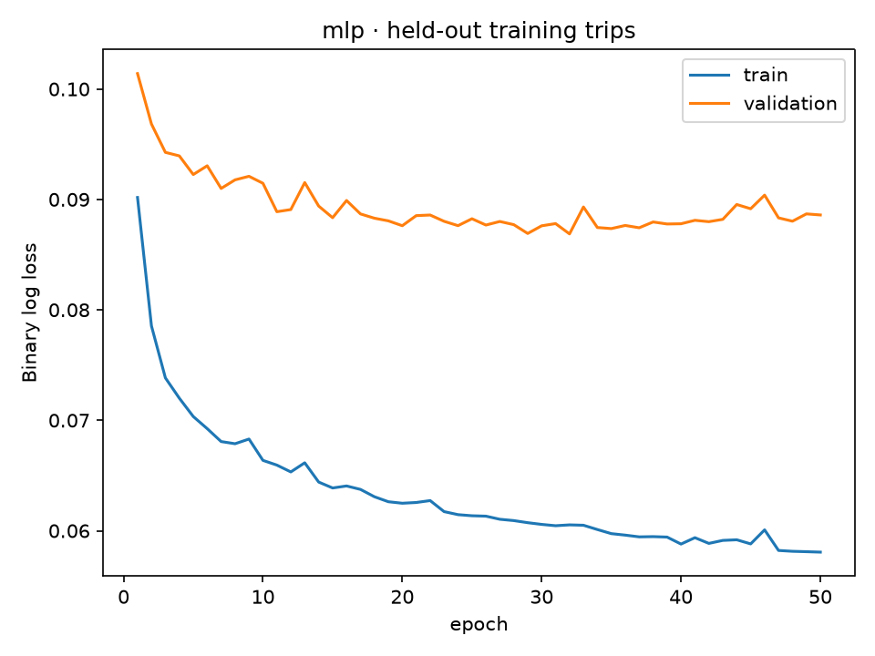
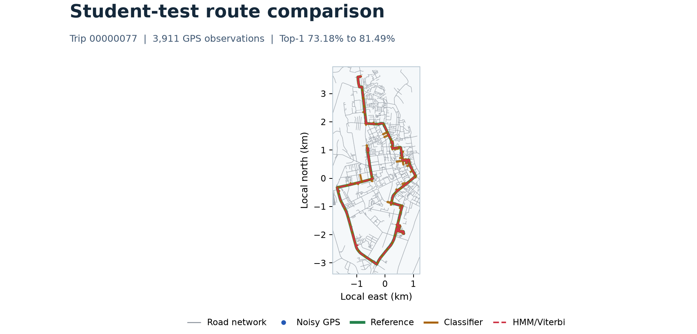

# PathSnap technical report

Rishi, Sanjit, Harsha, and Shailaja · UE24CS352A Machine Learning

## 1. Method and partition policy

PathSnap scores nearby directed arcs for each noisy GPS observation and uses Viterbi decoding to select an ordered route. The development archive supplied 80 training and 10 student-test trips. Model fitting, GroupKFold validation, Bayesian search and decoder tuning used training trips. Student-test trips measured development performance. The reserved evaluator split was excluded from this run.

## 2. Data and exploratory analysis

| Partition | Trips | GPS observations | Candidate rows | Candidate miss rate |
|---|---:|---:|---:|---:|
| train | 80 | 208,417 | 2,256,853 | 7.21% |
| student | 10 | 19,160 | 201,983 | 0.11% |

The median share of GPS samples one second apart was 99.14%. The longest observed interval was 153,064 seconds. A candidate miss occurs when the aligned reference arc is absent. Candidate generation uses up to 12 road arcs within 200 m, with a nearest-arc fallback. Features include distance and relative rank, heading alignment, position along the arc, speed, timing, and road connectivity. Point labels are derived by monotonically aligning the supplied reference route to the GPS observations.

Training fold 1 had the lowest reference-candidate coverage, 74.67%. That coverage bounds the Top-1 accuracy that any classifier can reach on the fold. Per-fold coverage is in `results/cv_candidate_coverage.csv`.

## 3. Supervised model comparison

| Model | Grouped CV Top-1 | CV Macro F1 | Student Top-1 | Student Macro F1 | Log loss | Student arc adjacency | Inference ms/1k rows |
|---|---:|---:|---:|---:|---:|---:|---:|
| LightGBM | 75.12% | 0.8977 | 87.10% | 0.9258 | 0.0640 | 72.95% | 8.60 |
| Random forest | 75.08% | 0.8980 | 86.14% | 0.9212 | 0.0660 | 73.53% | 3.37 |
| Multilayer perceptron | 74.53% | 0.8932 | 86.53% | 0.9154 | 0.0718 | 72.23% | 0.56 |
| Logistic regression | 73.16% | 0.8485 | 84.28% | 0.8869 | 0.1107 | 71.38% | 0.10 |
| K-nearest neighbors | 72.62% | 0.8729 | 84.07% | 0.8956 | 0.1137 | 69.36% | 349.93 |

Top-1 evaluates the highest-scoring arc for each observation. F1 and log loss use binary candidate rows. The student continuity column uses direct adjacency of consecutive distinct chosen arcs. Model selection used mean grouped-CV Top-1 with Macro F1 as a tiebreak.

### Logistic regression

A scaled linear probability baseline with inexpensive inference. A linear decision surface does not directly model feature interactions. The objective or scoring method is L2-regularized binary log loss.

The initial configuration was `{"C": 1.0, "max_iter": 1000, "solver": "lbfgs"}`.

The in-sample diagnostic on the first 20 training trips was 76.98%, versus 73.16% in grouped validation and 84.28% on student test. The training-to-CV difference was +3.83 points. The diagnostic subset can have a different trip mix from the folds, so this gap alone does not establish overfitting.

### K-nearest neighbors

Learns local patterns without a parametric decision surface. Neighbor queries are expensive. Training folds use a 100,000-row cap. The objective or scoring method is Distance-weighted voting after scaling.

The initial configuration was `{"n_neighbors": 25, "weights": "distance", "algorithm": "kd_tree", "leaf_size": 40}`.

The in-sample diagnostic on the first 20 training trips was 78.67%, versus 72.62% in grouped validation and 84.07% on student test. The training-to-CV difference was +6.05 points. The diagnostic subset can have a different trip mix from the folds, so this gap alone does not establish overfitting.

### Random forest

Represents nonlinear splits and averages many trees. Each tree uses a 20% bootstrap sample to bound training cost. The objective or scoring method is Gini impurity reduction across bagged trees.

The initial configuration was `{"n_estimators": 150, "max_depth": 16, "min_samples_leaf": 10, "max_features": "sqrt", "criterion": "gini", "max_samples": 0.2}`.

The in-sample diagnostic on the first 20 training trips was 80.95%, versus 75.08% in grouped validation and 86.14% on student test. The training-to-CV difference was +5.87 points. The diagnostic subset can have a different trip mix from the folds, so this gap alone does not establish overfitting.

### LightGBM

Learns interactions between geometric and road-topology features. Leaf capacity and boosting rounds affect runtime and overfitting. The objective or scoring method is Binary log loss optimized by gradient boosting.

The initial configuration was `{"n_estimators": 300, "learning_rate": 0.05, "num_leaves": 31, "min_child_samples": 30, "subsample": 0.85, "subsample_freq": 1, "colsample_bytree": 0.9, "reg_lambda": 0.5}`.

The in-sample diagnostic on the first 20 training trips was 81.64%, versus 75.12% in grouped validation and 87.10% on student test. The training-to-CV difference was +6.51 points. The diagnostic subset can have a different trip mix from the folds, so this gap alone does not establish overfitting.

### Multilayer perceptron

Learns nonlinear combinations of standardized candidate features. Each fitting fold is capped at 400,000 candidate rows. Convergence depends on optimization settings. The objective or scoring method is Binary cross-entropy with L2 regularization.

The initial configuration was `{"hidden_layer_sizes": [64, 32], "alpha": 0.001, "learning_rate_init": 0.001, "max_iter": 50, "batch_size": 1024, "early_stopping": false}`.

The in-sample diagnostic on the first 20 training trips was 79.36%, versus 74.53% in grouped validation and 86.53% on student test. The training-to-CV difference was +4.83 points. The diagnostic subset can have a different trip mix from the folds, so this gap alone does not establish overfitting.

## 4. Bayesian tuning and export

Optuna TPE completed 6 trials on LightGBM using grouped training CV Top-1. The best search configuration was `{"colsample_bytree": 0.7243186887373967, "learning_rate": 0.08890528335198394, "min_child_samples": 140, "n_estimators": 400, "num_leaves": 16, "reg_alpha": 0.0006053891567028107, "reg_lambda": 0.03549878832196503, "subsample": 0.9413549242801477}`. Completed search trials took 5.1 minutes in total.

During search, each fitting fold was capped at 350,000 candidate rows. Entire held-out validation trips were scored. The winning trial was rerun under the same fitting policy as its baseline before the final comparison.

The search covered these ranges.

- `n_estimators` · `IntDistribution(high=550, log=False, low=150, step=50)`
- `learning_rate` · `FloatDistribution(high=0.15, log=True, low=0.025, step=None)`
- `num_leaves` · `IntDistribution(high=95, log=False, low=15, step=1)`
- `min_child_samples` · `IntDistribution(high=150, log=True, low=15, step=1)`
- `subsample` · `FloatDistribution(high=1.0, log=False, low=0.65, step=None)`
- `colsample_bytree` · `FloatDistribution(high=1.0, log=False, low=0.65, step=None)`
- `reg_alpha` · `FloatDistribution(high=2.0, log=True, low=0.0001, step=None)`
- `reg_lambda` · `FloatDistribution(high=10.0, log=True, low=0.01, step=None)`

| Configuration | CV Top-1 | CV Macro F1 | Student Top-1 | Student Macro F1 | Log loss | Inference ms/1k rows | Fit seconds |
|---|---:|---:|---:|---:|---:|---:|---:|
| lightgbm | 75.12% | 0.8977 | 87.10% | 0.9258 | 0.0640 | 8.60 | 23.27 |
| lightgbm_tuned | 75.06% | 0.8974 | 86.81% | 0.9217 | 0.0662 | 8.10 | 28.34 |

The exported classifier is **lightgbm**, with 75.12% grouped CV Top-1. The full trial record and paired student diagnostics are under `results/`.

## 5. Route reconstruction on student test

At each timestamp, candidate arcs are hidden states and weighted log classifier scores are emissions. Transition scores measure the discrepancy between directed road distance and GPS displacement, adjusted for elapsed time. Viterbi maximizes the accumulated score and then recovers intermediate directed arcs. Unreachable transitions incur a penalty and appear as breaks. Candidate generation falls back to a nearest arc when a radius search returns no candidates. Large time gaps affect the distance search bound and transition weight.

| Method | Mean trip Top-1 | Directed transition continuity | Arc-overlap F1 |
|---|---:|---:|---:|
| Classifier only | 88.39% | 98.24% | 0.6135 |
| Classifier + Viterbi | 92.82% | 99.92% | 0.9037 |

Viterbi improved Top-1 on 10 of 10 trips and reduced it on 0. The largest decrease was 0.00 points. The training-OOF grid selected `{"beta": 15.0, "jump": -20.0, "w": 0.5}`. Arc-overlap F1 counts shared arcs with multiplicity. It does not measure traversal order.

## 6. Folium visualization

The map generator renders noisy GPS points, the road network, the reference route, classifier picks, and Viterbi reconstruction as separate layers. It can regenerate interactive student maps from the team's development data.

## 7. API and deployment

The local FastAPI rehearsal passed 10 of 10 requests. The median response round-trip time was 0.82 seconds on the test machine. The model and decoder are bound by SHA-256. The Streamlit client sends a trip ID and renders the returned GPS points, predicted route, and aggregate scores. The server reads reference routes after prediction for scoring. The physical two-laptop rehearsal is still pending.

## Reproducibility and disclosure

Run the commands in the project README with the organizer-provided development data. AI assistance was used to integrate and verify the pipeline and assemble this report from the observed run outputs. The metric values above were generated by the executed pipeline.
